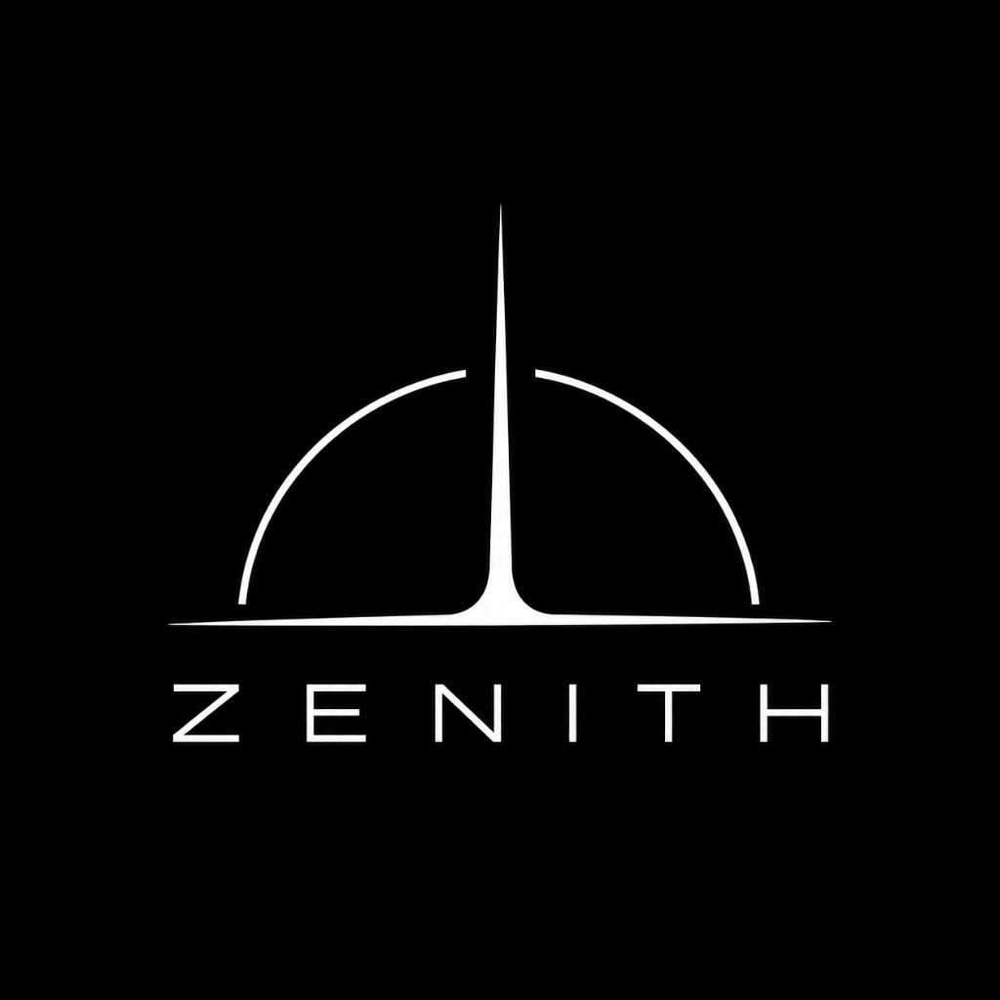
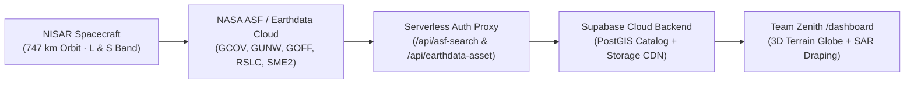

<div align="center">



# TEAM ZENITH // DANCING WITH SAR

### **NASA Space Apps Challenge 2026**
*Sense by Exploring — Tracking Earth’s Dynamic Surface Choreographies with NASA-ISRO Synthetic Aperture Radar (NISAR)*

[](https://www.spaceappschallenge.org/)
[](#03--orbital-instrument--cloud-architecture)
[](#05--nisar-mission-data-explorer-dashboard--user-guide)
[](#07--environment-variables--supabase-setup)
[](https://react.dev/)
[](https://vitejs.dev/)

---

</div>

## 01 // Challenge Overview

> *"Discover how radar reveals millimeter-scale changes on Earth’s surface — penetrating clouds, smoke, and polar night. From wetland subsidence to forest wildfires, fault slips, crop growth, and glacier acceleration, Earth is in a constant waltz of surface transformations."*

**Team Zenith** presents the interactive observatory and 3D orbital data explorer for **Dancing with SAR**—built for the **NASA Space Apps Challenge 2026**. By combining dual-frequency radar remote sensing from the joint **NASA–ISRO Synthetic Aperture Radar (NISAR)** mission with a **CesiumJS 3D Terrain Globe**, **authenticated NASA Earthdata Cloud streaming**, and a **Supabase PostGIS + Storage CDN backend**, our platform translates complex microwave backscatter, interferometric phase shifts (InSAR), and L3 soil moisture grids into an intuitive, accessible visual experience.

---

## 02 // Six Perspectives on a Dynamic Planet

Unlike optical sensors blinded by cloud cover, wildfire smoke, or polar night, NISAR illuminates Earth's surface day and night across five core environmental choreographies—powered by an all-weather dual-band radar vision capability:

| Index | Perspective | Category | Radar Band | Key Telemetry / Feature | Reference Region |
| :--- | :--- | :--- | :--- | :--- | :--- |
| **01** | **Glacier Movement** | Surface Motion | `L-Band (24 cm)` | `38.4 m/day` Ice-Stream Velocity | Jakobshavn Isbræ · `69.160° N` |
| **02** | **Earthquakes** | Crustal Slip | `L-Band InSAR` | `±14.2 cm` Line-of-Sight Deformation | Anatolian Fault · `37.220° N` |
| **03** | **Forest Wildfires** | Biomass Disturbance | `L + S Dual Band` | `-6.8 dB` HV Canopy Backscatter | Boreal & Amazonia · `11.450° S` |
| **04** | **Wetland Loss** | Hydrologic Change | `L-Band HH/VV` | `-18.5 mm/yr` Deltaic Subsidence | Sundarbans Delta · `21.940° N` |
| **05** | **Farming Activities** | Agricultural Rhythm | `S-Band (10 cm)` | `12-Day Cycle` Repeat-Pass Cadence | Indo-Gangetic Plain · `30.900° N` |
| **06** | **All-Weather Radar Vision** | Radar Capability | `L + S Dual Band` | `24 cm + 10 cm λ` All-Weather Penetration | Global Earth Orbit · `747 km` |

---

## 03 // Orbital Instrument & Cloud Architecture



- **L-Band Radar (`24 cm λ` · NASA)**: Penetrates dense forest canopies and dry snowpack to measure sub-surface crustal deformation, wetland inundation, and glacial flow.
- **S-Band Radar (`10 cm λ` · ISRO)**: High sensitivity to agricultural crop structure, light vegetation, and surface moisture dynamics.
- **12-Day Global Cadence**: Images Earth’s land and ice-covered surfaces every 12 days on both ascending and descending orbital tracks.

---

## 04 // Design System & Landing Experience (`/`)

- **Dark Obsidian & Alabaster Minimalism**: Engineered with a deep void-black (`#040406`) and obsidian (`#08080C`) palette paired with crisp alabaster typography (`#F4F4F6`) and restrained crimson/violet radar accents (`#E11D48`, `#FB7185`, `#8B5CF6`, `#A78BFA`) — strictly zero cyan and zero gold.
- **Plain-Language Scientific Clarity**: Clear, above-the-fold mission statement explaining radar technology in plain language alongside technical aerospace typography.
- **3D Planetary SAR Hero Globe (`EarthHorizonHero.jsx`)**: Uncluttered visual focal point featuring 7 latitude parallels, 5 longitude meridian ellipses, continental point-cloud constellations, sweeping radar swaths, and high-contrast telemetry badge (`CRYO // GLACIER · 38.4 m/day · 12-DAY REPEAT PASS`).
- **Scroll-Synced Frosted Navbar**: Real-time ScrollSpy navigation with descriptive tabs (`01 // Overview`, `02 // Earth Observations`, `03 // How Radar Works`, `04 // About the Team`) and primary CTA **`Open Data Explorer ↗`**.

---

## 05 // NISAR Mission Data Explorer (`/dashboard`) — User Guide

Navigate to **`/dashboard`** (or click **`Open Data Explorer ↗`** on the landing page) to launch the **NISAR 3D Mission Data Explorer**.

### Layout Architecture (Master Redesign Scientific Workspace)
- **Top Command Station (`.x-earthdata-bar`)**: Sleek, human-friendly scientific command center:
  - **Case Study Region Cards**: Direct access to verified Earth observation regions (*Bengal Delta* · 23.81°N, *Eastern Himalayas* · 27.65°N, *Sundarbans Coast* · 21.95°N, *Svalbard Arctic* · 77.52°N, and *Meghna Baseline* · 154 calibrated swaths) complete with coordinate tags and plain-English environmental descriptions.
  - **Featured L3 Science Product**: Highlighted **`561-Pixel L3 Soil Moisture Grid`** card for instant fly-to over Svalbard with active violet glow.
  - **Custom Global Coordinates Search Tool**: Labeled numeric fields for Latitude (`°N`) and Longitude (`°E`) with focus states and a dedicated **`Query NASA CMR`** CTA.
  - **Live Telemetry & Recovery Strip**: Shield-verified connection status with a one-click **`Restore Baseline Archive`** action.
- **Consolidated Horizontal Filter & Telemetry Toolbar (`CatalogFilters.jsx`)**: A sleek horizontal command bar integrating Product Type selector, Date From/To pickers, Reset button (`white-space: nowrap`), and real-time pass count / coverage metrics (`Matching Passes: N / Total`, `Coverage`, `12-Day Cycle`).
- **Primary Geospatial Stage (70% / 30% Widescreen Bento Grid)**:
  - **Left Column (70% width, 3D Terrain Globe)**: 590px-tall interactive **CesiumJS 3D Globe** with Cesium World Terrain elevation meshes, CARTO dark vector basemap tiles, orbital swath footprints, draped L-band SAR radar imagery, Svalbard 561-pixel L3 soil moisture point cloud, **translucent frosted-glass camera controls** (`3D Peaks`, `Svalbard L3`, `Target`, `Globe`, `L0B Strips`), docked `ComparePairBar`, and a **docked frosted-glass legend HUD** (`backdrop-filter: blur(18px)`) integrated directly inside the viewport bottom.
  - **Right Column (30% width, Observation Timeline)**: Chronological acquisition timeline matched flush to the globe's full 590px height, with smooth vertical scrolling, repeat-pass pair badges, and non-overlapping 3-column flex layout (`[Rail] [Content] [Actions]`) so `[Pair]`, `[A]`, and `[B]` buttons never collide with granule IDs.
- **Secondary Inspection Workbench (`RecordDetails.jsx`)**:
  - Interactive multi-mode tab switcher (`Overview (3-Pane)`, `03 // Metadata & Assets`, `04 // SAR Browse`, `05 // QA & Database`):
    - **`03 // Metadata & Assets`**: Granule metadata, standardized coordinates (`26.714° N, 89.772° E`), primary `Download HDF5`, `Copy URL`, `Pin Watchpoint`, and companion cloud assets (`QA Report PDF`, `QA Summary CSV`, `ISCE3 RunConfig YAML`, `ISO 19115 XML`) styled with `white-space: nowrap` and standard heights.
    - **`04 // SAR Browse Imagery`**: Real L-band SAR browse raster viewer with multi-frequency polarization tabs, geocoded **`Draped on 3D Globe`** toggle, and direct full PNG view.
    - **`05 // QA Telemetry & Database Watchpoints`**: Live parsed `*_QA_SUMMARY.csv` verification checks and synced **Mission Watchpoints** stored in the database.
  - **Multi-Temporal Comparison Studio**: When comparing two granules, automatically expands into a specialized comparison suite featuring 4 change metric cards (Permanent Water, Flood Inundation, Water Receded, Net Delta), threshold sensitivity slider (-24 dB to -12 dB with Otsu bimodal auto detection), backscatter histogram, InSAR phase hygiene rules, and responsive stacking export CTAs (`Export Report JSON`, `Download PNG Mask`).

### How to Use Every Feature on `/dashboard`

1. **Explore the Widescreen 3D Terrain Globe**:
   - **Orbit / Pan**: Left-click and drag on the globe.
   - **Zoom**: Scroll wheel (or pinch on trackpad).
   - **Tilt for 3D Mountain Relief**: Hold `Ctrl` (or `Cmd` on macOS) + left-click drag (or middle-click drag) to tilt the camera and inspect 3D mountain terrain in the Eastern Himalayas or Svalbard fjords.
   - **Select Any Footprint**: Click any SAR polygon on the globe (`Violet` = Ascending track, `Rose` = Descending track, `Crimson + White Border` = Selected) to fly the camera to that swath and automatically drape its real L-band radar image over the 3D terrain.
   - **Inspect the In-Globe Legend**: Check the docked frosted-glass HUD at the bottom of the globe for track indicators, active draped SAR states, or dual-date change detection layers.

2. **Query Live NASA Earthdata Cloud Data by Region or Coordinates**:
   - Select any of the scientifically rich case study cards in the Command Station:
     - **`Bengal Delta`** (`23.81°N · 90.41°E` — Monsoon Inundation & River Hydrology)
     - **`Eastern Himalayas`** (`27.65°N · 91.75°E` — Mountain Glaciers & Elevation Meshes)
     - **`Sundarbans Coast`** (`21.95°N · 89.18°E` — Tidal Mangrove & Shoreline Loss)
     - **`Svalbard Arctic`** (`77.52°N · 13.94°E` — Permafrost & Cryosphere Calibration)
     - **`Meghna Baseline`** (Calibrated Archive — 154 full-coverage swaths)
   - Or enter custom coordinates into the **`Lat (°N)`** and **`Lon (°E)`** fields and click **`Query NASA CMR`** to fetch live NISAR granules anywhere on Earth. Click **`Restore Baseline Archive`** at any time to return to the local calibrated dataset.

3. **Inspect the 561-Pixel L3 Soil Moisture (`SME2`) EASE-Grid 2.0**:
   - Click **`561-Pixel L3 Soil Moisture Grid`** in the top command bar.
   - The 3D globe flies directly to **Spitsbergen, Svalbard (`77.52°N, 13.94°E`)** and renders all **561 valid 200m pixels** (`0.088 – 0.349 cm³/cm³`) extracted from the NISAR L3 `SME2` HDF5 granule, while Panel `05` displays the volumetric soil moisture distribution (`0.088 min`, `0.214 mean`, `0.349 max cm³/cm³`).

4. **Filter & Step Through Chronological Acquisitions**:
   - In **`01 // CONTROLS`**, filter granules by **Product Type** (`GCOV`, `GUNW`, `GOFF`, `GSLC`, `RSLC`, `SME2`, `RRSD`, `RIFG`, `RUNW`, `ROFF`) or **Acquisition Window** (`Start date` / `End date`).
   - In **`03 // TIMELINE`**, click any acquisition in the chronological list (or use `↑` / `↓` arrow keys) to update the 3D globe and all three inspection panels below.

5. **Stream Real SAR Browse Imagery, QA CSV Checks & Companion Files**:
   - In **`04 // SELECTED RECORD`**, click **`Download HDF5`** to stream the science granule, or click the companion chips (**`QA Report PDF`**, **`QA Summary CSV`**, **`ISCE3 RunConfig YAML`**, **`ISO 19115 XML`**) to open authenticated NASA Earthdata assets via `/api/earthdata-asset`.
   - In **`05 // AUTHENTICATED NISAR SAR IMAGERY`**, view the real L-band radar backscatter browse PNG cached through Supabase Storage CDN (`nisar-browse-cache`), switch polarization tabs, or toggle **`Draped on 3D Globe`**.
   - In **`06 // TELEMETRY & SUPABASE CLOUD`**, inspect real-time **`PASS` / `WARN`** quality checks parsed directly from the granule's `*_QA_SUMMARY.csv`.

6. **Save & Sync Mission Watchpoints with Supabase Cloud**:
   - Click **`Pin to Supabase`** in **`04 // SELECTED RECORD`** to save the currently selected NISAR granule (with its coordinates, product type, and track/frame metadata) to the **`mission_watchpoints`** PostGIS table in Supabase Cloud.
   - In **`06 // TELEMETRY & SUPABASE CLOUD`**, click any saved watchpoint card to jump directly to its pinned granule on the 3D globe, or click the trash icon to remove it.

---

## 06 // Project Structure

```text
web app/
├── api/
│   ├── asf-search.js                 # Live NASA ASF CMR spatial search proxy + Supabase upsert
│   ├── earthdata-asset.js            # NASA Earthdata OAuth redirect resolver + Supabase Storage CDN cache
│   └── watchpoints.js                # CRUD API for Supabase Cloud mission_watchpoints
├── public/
│   └── zenith-logo.png               # Official Team Zenith emblem
├── resources/
│   ├── asf-results-2026-10-08_23-06-00.json  # 153 NISAR SAR granules (Meghna-Brahmaputra basin)
│   └── NISAR_L3_PR_SME2_*.h5         # Real NISAR L3 Soil Moisture (SME2) NetCDF4/HDF5 granule
├── scripts/
│   └── setup-supabase.mjs            # Automated Supabase Storage bucket & 154-granule seed script
├── supabase/
│   └── schema.sql                    # PostgreSQL + PostGIS (extensions schema) + RLS policies
├── src/
│   ├── components/
│   │   ├── EarthHorizonHero.jsx      # 3D spherical SAR globe hero visual
│   │   ├── SurfaceWaltzCards.jsx     # 5 surface-change frosted glass cards & SVG radar waves
│   │   └── ZenithElements.jsx        # Vector emblem, FrostedCard, GlassButton & HUD marks
│   ├── features/
│   │   └── explorer/
│   │       ├── CatalogFilters.jsx    # 01 // CONTROLS filter panel
│   │       ├── CatalogTimeline.jsx   # 03 // TIMELINE chronological selector
│   │       ├── ExplorerPage.jsx      # /dashboard 2-Tier Widescreen Command Center
│   │       ├── GlobeViewer.jsx       # 02 // 3D TERRAIN GLOBE (CesiumJS + SAR draping + SME2 grid)
│   │       ├── RecordDetails.jsx     # 3-Column Inspection Deck (04 Record | 05 SAR | 06 Telemetry)
│   │       ├── SyntheticPreview.jsx  # Fallback radar geometry preview for raw L0/L1 granules
│   │       ├── catalog.js            # WKT polygon parser, normalizer & filter engine
│   │       └── sme2Data.js           # Extracted 561-pixel L3 Soil Moisture EASE-Grid 2.0 coordinates
│   ├── lib/
│   │   └── supabaseClient.js         # Browser & server Supabase client helpers
│   ├── App.jsx                       # Scroll-synced navbar, hero frame, SPACE/EARTH sections
│   ├── index.css                     # Custom frosted-glass & dot-matrix utilities
│   └── main.jsx                      # React 18 router entry point (/ and /dashboard)
├── PROGRESS.md                       # Detailed engineering log & operator handbook
├── package.json                      # Scripts & dependencies
├── vercel.json                       # Vercel serverless API & SPA routing configuration
└── vite.config.js                    # Vite bundler + local serverless middleware plugin
```

---

## 07 // Environment Variables & Supabase Setup

Create a `.env` file in the root directory (`web app/.env`):

```env
# CARTO Basemaps & Cesium Ion 3D World Terrain
VITE_CARTO_API_KEY=your_carto_api_key
VITE_CESIUM_ION_TOKEN=your_cesium_ion_token

# NASA Earthdata Login JWT Bearer Token
EARTHDATA_TOKEN=your_nasa_earthdata_jwt_token

# Supabase Cloud Backend (PostgreSQL + PostGIS + Storage CDN)
VITE_SUPABASE_URL=https://your-project-ref.supabase.co
VITE_SUPABASE_ANON_KEY=your_supabase_anon_key
SUPABASE_SERVICE_ROLE_KEY=your_supabase_service_role_key
```

### Initializing a New Supabase Project
1. Open your **Supabase Dashboard → SQL Editor** and execute [`supabase/schema.sql`](./supabase/schema.sql). (This installs `postgis` inside the `extensions` schema and enables Row-Level Security on `public.nisar_granules`, `public.mission_watchpoints`, and `public.asf_query_cache`.)
2. Provision the storage buckets (`nisar-browse-cache` and `nisar-mission-store`) and seed all 154 NISAR granules + 3 default watchpoints:
   ```bash
   node scripts/setup-supabase.mjs
   ```

---

## 08 // Getting Started

```bash
# 1. Install dependencies
npm install

# 2. Launch the development server (with local /api/* middleware enabled)
npm run dev

# 3. Build for production
npm run build

# 4. Preview production build locally
npm run preview
```

---

<div align="center">

**Crafted by TEAM ZENITH**  
*NASA Space Apps Challenge 2026 · Dancing with the SARs*

</div>
