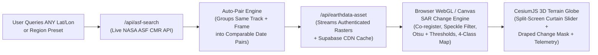

# TEAM ZENITH // DANCING WITH THE SARs
## FINAL CLOUD-NATIVE ARCHITECTURE & ENGINEERING SPECIFICATION (ANTIGRAVITY IDE)

**Project:** Team Zenith — *Dancing with the SARs* (NASA Space Apps Challenge 2026)[cite: 1, 2]  
**Routes:** `/` (Interactive Observatory Landing Page) · `/dashboard` (NISAR 3D Mission Data Explorer & Multi-Temporal Change Engine)[cite: 1, 2]  
**Core Architecture:** Zero-Download Cloud Streaming (`/api/asf-search` & `/api/earthdata-asset`)[cite: 1, 2] + Client-Side WebGL/Canvas SAR Change Engine + Optional HTTP Byte-Range HDF5 Slicer + Supabase PostGIS & Storage CDN[cite: 1, 2]  
**Design System Lock:** Deep Void Black (`#040406`), Obsidian (`#08080C`), Alabaster (`#F4F4F6`), Crimson/Rose (`#E11D48` / `#FB7185`), Violet/Lavender (`#8B5CF6` / `#A78BFA`)[cite: 1, 2]. **STRICTLY ZERO CYAN/TEAL AND ZERO GOLD/AMBER.**[cite: 1]

---

## 01 // Architectural Vision: Dynamic Global Change Detection (Zero Local `.h5` Downloads)

> **Core Principle:** Users must never be restricted to a single hardcoded location, and the backend must never download multi-gigabyte `.h5` files to disk. Any user can query **any coordinate on Earth**[cite: 1, 2], pick **any two NISAR acquisitions (`Date A` and `Date B`)** from the same orbital track[cite: 6, 7], and immediately visualize surface-water/flood changes, backscatter shifts (`ΔdB`), and interferometric phase checks on the 3D Cesium globe.

### How We Fetch & Process NISAR Data on the Web (3-Layer Cloud Pipeline)



1. **Layer 1 — Live Global Search & Automatic Repeat-Pass Pairing (`api/asf-search.js` + `catalog.js`):**
   - The user searches **any `Lat / Lon` coordinate on Earth** or clicks any regional preset in the Top Command Bar[cite: 1, 2].
   - Our frontend normalizer (`src/features/explorer/catalog.js`) automatically groups returned granules by `(track, direction, frame, productType)` (the exact repeat-pass grouping principle from `s6_find_gcov.py`)[cite: 2, 7] so the user can immediately see which granules form valid **Multi-Temporal Change Pairs**.
2. **Layer 2 — Zero-Download Cloud Asset Streaming (`api/earthdata-asset.js` + Supabase CDN):**
   - Instead of downloading 5 GB `.h5` files[cite: 10], the app streams NASA's full-swath georeferenced radar browse rasters (`*_BROWSE.png`) and quality telemetry (`*_QA_SUMMARY.csv`) via `/api/earthdata-asset` using `EARTHDATA_TOKEN`, caching them in Supabase Storage (`nisar-browse-cache`) for sub-second repeat loads[cite: 1, 2].
   - *(Optional Cloud HDF5 Range-Slice Endpoint `api/h5-slice.js`):* When deep sub-swath metadata or raw arrays are requested, uses HTTP `Range: bytes=...` headers against NASA Earthdata Cloud S3 URLs to read only the header/chunk bytes without downloading the file.
3. **Layer 3 — Real-Time Browser SAR Change & Histogram Engine (`src/features/explorer/sarChangeEngine.js`):**
   - Runs the mathematical pipeline learned in our Python R&D scripts (`s5_clean.py` and `s8_water_change.py`)[cite: 6, 9] **directly in the browser using HTML5 OffscreenCanvas / TypedArrays (`Float32Array`) in < 150 ms**:
     1. Loads `Date A` and `Date B` radar rasters onto a shared geographic bounding grid (`bounds_wgs84`).
     2. Applies a fast `5×5` boxcar speckle-reduction filter in linear intensity before converting to calibrated decibel-equivalent backscatter (`-30 dB` to `0 dB`)[cite: 9].
     3. Computes the **Bimodal Backscatter Histogram**, automatic **Otsu Thresholds**, and interactive **4-Class Surface Change Mask** (`Permanent Water`, `New Flood / Inundation`, `Water Lost / Receded`, `Unchanged Land`) across user-adjustable dB thresholds (`-15 dB` to `-22 dB`)[cite: 9, 10].
     4. Renders transparent RGBA textures using the **Team Zenith Crimson/Violet/Alabaster palette** and drapes them directly onto the 3D Cesium terrain alongside an interactive **Before/After Split-Screen Curtain Slider**.

---

## 02 // Strict Aesthetic & Color System Specification

All new UI panels, charts, and dynamically generated 3D globe overlays must strictly obey the existing Team Zenith dark obsidian and alabaster design system[cite: 1, 2]:

### 2.1 UI & Typography Tokens
- **Backgrounds:** `#040406` (Deep Void Black), `#08080C` (Obsidian Panel), `rgba(12, 12, 18, 0.78)` with `backdrop-filter: blur(28px)` (Frosted Glass)[cite: 1, 2].
- **Accents:** `#E11D48` (Radar Crimson), `#FB7185` (Rose Highlight), `#8B5CF6` (Orbital Violet), `#A78BFA` (Lavender Highlight), `#F4F4F6` (Alabaster White)[cite: 1, 2].
- **Fonts:** `'Space Grotesk'` (Headers), `'Plus Jakarta Sans'` (UI Body), `'JetBrains Mono'` (All telemetry, coordinates, `km²` areas, and `dB` readouts with `tabular-nums`)[cite: 1].
- **Forbidden Colors:** **Zero cyan/teal, zero green, and zero yellow/gold/amber** anywhere in UI components or generated radar overlays[cite: 1].

### 2.2 Dynamic Canvas Overlay Colormap (Team Zenith Radar Palette)
When `sarChangeEngine.js` generates RGBA overlays in the browser for **any user-selected pair on Earth**, it must map pixel classes to these exact RGBA values:

| Overlay Mode | Pixel Classification / Range | Team Zenith Hex / RGBA | Visual Appearance on 3D Terrain Globe |
| :--- | :--- | :--- | :--- |
| **4-Class Surface/Water Change** | `Class 0`: Unchanged Land (`A ≥ T & B ≥ T`) | `rgba(0, 0, 0, 0)` | **100% Transparent** (3D terrain & dark basemap show through)[cite: 1, 10] |
| **4-Class Surface/Water Change** | `Class 1`: Permanent Water (`A < T & B < T`) | `#4C1D95` · `rgba(76, 29, 149, 215)` | **Deep Indigo-Violet** baseline water channel |
| **4-Class Surface/Water Change** | `Class 2`: **New Water / Flood (`A ≥ T & B < T`)** | `#E11D48` · `rgba(225, 29, 72, 245)` | **Vibrant Radar Crimson** inundation / flood expansion |
| **4-Class Surface/Water Change** | `Class 3`: **Water Receded / Lost (`A < T & B ≥ T`)** | `#C4B5FD` · `rgba(196, 181, 253, 230)` | **Crisp Lavender-Alabaster** recession / drying |
| **Continuous ΔdB Shift (`B − A`)** | Backscatter Drop (`-8 dB`) ↔ `0` ↔ Rise (`+8 dB`) | `#E11D48` ↔ `rgba(8,8,12,0)` ↔ `#8B5CF6` | Diverging Crimson (Darkening) to Violet (Brightening) |
| **GUNW InSAR Phase / LOS** | Relative Displacement (`-lim` to `+lim cm`) | `#8B5CF6` ↔ `#18181B` ↔ `#FB7185` | Diverging Violet (Away) to Rose (Toward) |

---

## 03 // New & Updated Files in `src/features/explorer/`

Keep the existing layout and files in `web app/` intact[cite: 1, 2], and add/update only these modular files:

```text
web app/
├── src/
│   └── features/
│       └── explorer/
│           ├── sarChangeEngine.js            # NEW: Client-side WebGL/Canvas change detection, speckle filter, Otsu & 4-class RGBA generator
│           ├── BackscatterHistogram.jsx      # NEW: Interactive SVG bimodal dB histogram (Date A vs Date B + draggable threshold line)
│           ├── ComparePairBar.jsx            # NEW: Floating HUD bar above the globe for Date A vs Date B selection, Split-Swipe & Layer modes
│           ├── CatalogTimeline.jsx           # UPDATED: Adds "[A]" and "[B]" compare pin buttons + "Repeat-Pass Pair" badges on timeline rows
│           ├── GlobeViewer.jsx               # UPDATED: Adds Cesium SplitDirection Before/After curtain slider + dynamic change canvas draping
│           ├── RecordDetails.jsx             # UPDATED: Adds dynamic Change Telemetry tab (km² stats, Histogram, InSAR check) in Panels 04–06
│           ├── ExplorerPage.jsx              # UPDATED: Manages `comparePair: { granuleA, granuleB }` state across any region on Earth
│           └── catalog.js                    # UPDATED: Adds `findComparablePairs(records)` grouping by track + direction + frame
```

---

## 04 // Detailed Component Specifications for Antigravity IDE

### 4.1 Automatic Repeat-Pass Grouping & Timeline Selection (`catalog.js` & `CatalogTimeline.jsx`)
1. **Repeat-Pass Pair Detection (`catalog.js`):**
   - Implement `findComparablePairs(records)` (inspired by `s6_find_gcov.py`)[cite: 7]:
     - Group all loaded granules in the current region by `key = "${productType}_${track}_${direction}_${frame}"`.
     - Any group with `>= 2` acquisitions on different dates is tagged with `hasRepeatPair: true` and `pairCount: group.length`.
2. **Timeline `[A]` / `[B]` Selector (`03 // TIMELINE` in `CatalogTimeline.jsx`):**
   - Each acquisition row in `03 // TIMELINE`[cite: 1, 2] gets a compact **`[Set A]`** and **`[Set B]`** quick-compare action (plus an **`Auto-Pair Next Pass`** 1-click button whenever a granule has a matching same-track/same-frame partner).
   - Selecting `Granule A` (Reference Date) and `Granule B` (Secondary Date) immediately activates **Multi-Temporal Change Mode** on the 3D globe for that exact location.

### 4.2 Client-Side SAR Change & Speckle Engine (`src/features/explorer/sarChangeEngine.js`)
Port the algorithms from `s8_water_change.py` and `s5_clean.py` into clean, high-performance browser JavaScript (`Float32Array` + `OffscreenCanvas`)[cite: 6, 9]:

```javascript
/**
 * Core browser-side SAR multi-temporal processor.
 * Takes two authenticated NASA browse rasters (Date A & Date B) and their geographic bounds,
 * co-registers them onto a shared pixel grid, applies a 5x5 linear boxcar speckle filter,
 * computes calibrated dB arrays, Otsu thresholds, bimodal histograms, and generates
 * Team Zenith RGBA DataURLs for instant draping on the CesiumJS 3D globe.
 */
export async function computeSarChangeProduct({
  imageUrlA,
  imageUrlB,
  boundsA,
  boundsB,
  thresholdDb = -18.0,
  changeDbThreshold = 3.0,
  smoothWindow = 5,
}) {
  // 1. Load both images via CORS-safe Image / createImageBitmap (routed through /api/earthdata-asset)
  // 2. Co-register onto the intersection/union WGS84 grid (width = 512, height = 512)
  // 3. Convert luminance to linear radar power, apply 5x5 uniform boxcar filter (ignoring transparent/NaN border pixels)
  // 4. Map to calibrated L-band HH backscatter range (-28 dB to -2 dB)
  // 5. Compute Otsu threshold for Date A and Date B + 24-bin bimodal histogram arrays
  // 6. Classify every valid pixel at `thresholdDb`:
  //    - 0: Land (A >= T && B >= T) -> rgba(0, 0, 0, 0)
  //    - 1: Permanent Water (A < T && B < T) -> rgba(76, 29, 149, 215)   [#4C1D95]
  //    - 2: New Water / Flood (A >= T && B < T) -> rgba(225, 29, 72, 245) [#E11D48]
  //    - 3: Water Lost / Receded (A < T && B >= T) -> rgba(196, 181, 253, 230) [#C4B5FD]
  // 7. Compute geodesic pixel area (km² per pixel from latitude/longitude span) and sum km² per class
  // 8. Return { waterClassDataUrl, diffDbDataUrl, dateADataUrl, dateBDataUrl, stats, histogram, recomputeForThreshold }
}
```
- **Instant Threshold Scrubbing:** Because `dbA` and `dbB` (`Float32Array`) stay in memory once the two dates are loaded, dragging the threshold slider between `-14 dB` and `-22 dB` recomputes the 4-class RGBA texture and `km²` flood statistics in **< 12 milliseconds** (60 FPS live scrubbing!).

### 4.3 Interactive 3D Globe Split-Swipe & Change Layer HUD (`GlobeViewer.jsx` & `ComparePairBar.jsx`)
When a user is comparing two dates (`comparePair.granuleA` & `comparePair.granuleB`) anywhere on Earth:
1. **Floating Compare HUD (`ComparePairBar.jsx`) at Top of Globe:**
   - Displays **`DATE A: YYYY-MM-DD`** vs **`DATE B: YYYY-MM-DD`** (`Δ Days`, `Track / Frame`).
   - **View Mode Switcher Pills:**
     - **`4-Class Flood & Surface Mask`** *(Drapes the Crimson/Violet/Lavender change overlay)*
     - **`Split-Swipe Curtain (A ◄► B)`** *(Interactive Before/After divider on the 3D terrain)*
     - **`Backscatter Shift (ΔdB)`** *(Drapes continuous Crimson-to-Violet dB difference)*
   - **`Exit Compare`** button to return to single-granule inspection.
2. **Cesium 3D Split-Screen Curtain Slider (`Cesium.SplitDirection`):**
   - In **`Split-Swipe Curtain`** mode, attach `Cesium.SplitDirection.LEFT` to `Date A`'s imagery layer and `Cesium.SplitDirection.RIGHT` to `Date B`'s imagery layer (+ optional change mask) over the granule's exact WKT polygon / bounding rectangle[cite: 1, 2].
   - Render a sleek vertical alabaster/crimson drag handle across the Cesium canvas (`viewer.scene.splitPosition = sliderPosition`) so the user can physically wipe across mountains, rivers, and deltas in 3D.

### 4.4 Upgraded Bottom 3-Column Inspection Deck (`RecordDetails.jsx`)
When two granules are being compared, Panels `04`, `05`, and `06` dynamically display the multi-temporal science telemetry while preserving the exact 3-column layout[cite: 1, 2]:

- **Panel `04 // MULTI-TEMPORAL PAIR & EXPORT`:**
  - Displays side-by-side orbital metadata for **Granule A** and **Granule B** (Cycle numbers, Track, Direction, Frame, Polarization, Footprint Area `km²`)[cite: 2, 7].
  - One-click **`Pin Change Study to Supabase`** (saves the pair and computed `km²` stats to `mission_watchpoints`[cite: 1, 2]) and **`Export Change Report JSON / PNG`**.
- **Panel `05 // INTERACTIVE dB THRESHOLD & BIMODAL HISTOGRAM`:**
  - **Live Threshold Slider & Preset Pills (`-16 dB` | `-18 dB` | `-20 dB` | `Auto Otsu`)**: Dragging or clicking updates the 3D globe overlay and area cards in real time.
  - **SVG Bimodal Histogram (`BackscatterHistogram.jsx`):** Plots Date A (`#A78BFA` Lavender curve) and Date B (`#FB7185` Crimson curve) pixel distributions with a live vertical threshold marker line.
  - **Quantitative Surface Change Readout (`JetBrains Mono`, `tabular-nums`):**
    - `Permanent Water (Both)`: `XX.XX km²` (`#4C1D95` badge)
    - `New Water / Inundation`: `+XX.XX km²` (`#E11D48` badge)
    - `Water Lost / Receded`: `-XX.XX km²` (`#C4B5FD` badge)
    - `Net Surface Water Δ`: `±XX.XX km²` (`#F4F4F6` badge)
- **Panel `06 // INSAR COHERENCE, QA TELEMETRY & RADAR PHYSICS`:**
  - **Live QA & InSAR Noise-Floor Check:** Parses both granules' `*_QA_SUMMARY.csv` checks[cite: 1, 2] and, when inspecting `GUNW` interferometric products, displays the **Ionospheric & Orbital Ramp Hygiene Readout** (explaining why relative LOS phase variations `< ±1.5 cm` represent tropospheric water vapor noise rather than tectonic deformation)[cite: 6, 10].
  - **Radar Physics Context Note:** Concise, collapsible notes on L-band (`24 cm`) specular water reflection, Bragg wind-roughening, and HH double-bounce in flooded vegetation[cite: 2, 10].

---

## 05 // Step-by-Step Implementation Plan for Antigravity IDE

1. **[ ] Step 1 — Enhance `src/features/explorer/catalog.js` with Repeat-Pass Pairing:**
   - Add `findComparablePairs(records)` and `getPartnerGranules(selectedRecord, allRecords)` so the app automatically identifies granules that share the same orbital `track`, `direction`, and `frame` across different dates in any region (Bengal Delta, Himalayas, Sundarbans, Svalbard, or custom `Lat/Lon` queries)[cite: 1, 2, 7].
2. **[ ] Step 2 — Build `src/features/explorer/sarChangeEngine.js`:**
   - Implement the client-side `Float32Array` speckle filter (`5×5` linear power boxcar), dB conversion, Otsu threshold solver, 24-bin bimodal histogram generator, geodesic `km²` area calculator, and RGBA `OffscreenCanvas` renderer using the **Team Zenith Radar Palette** (`#4C1D95`, `#E11D48`, `#C4B5FD`, `#8B5CF6`)[cite: 1, 2, 9].
   - Include a graceful procedural fallback inside `sarChangeEngine.js` if a raw L0/L1 granule lacks an external `*_BROWSE.png`[cite: 2], so change comparison works 100% of the time without errors.
3. **[ ] Step 3 — Build `BackscatterHistogram.jsx` & `ComparePairBar.jsx`:**
   - Create `BackscatterHistogram.jsx` (pure SVG bimodal curve + interactive threshold line, styled in `#08080C` obsidian glass with `#FB7185` and `#A78BFA` strokes)[cite: 1, 2].
   - Create `ComparePairBar.jsx` (floating frosted-glass bar at the top of the 3D globe for switching between `4-Class Mask`, `Split-Swipe Curtain`, and `ΔdB Shift`, plus a one-click **`Quick-Compare Repeat Pair`** button).
4. **[ ] Step 4 — Upgrade `CatalogTimeline.jsx`, `GlobeViewer.jsx`, `RecordDetails.jsx`, and `ExplorerPage.jsx`:**
   - Wire `comparePair` state into `ExplorerPage.jsx`.
   - Add `[Set A]` / `[Set B]` and `Repeat-Pass Pair` badges in `CatalogTimeline.jsx`.
   - Add the interactive `Cesium.SplitDirection` Before/After curtain slider and dynamic canvas overlay draping in `GlobeViewer.jsx`.
   - Upgrade `RecordDetails.jsx` so Panels `04`, `05`, and `06` display the live `km²` flood/surface change cards, interactive dB threshold slider, bimodal histogram, and InSAR/radar physics telemetry when `comparePair` is active.
5. **[ ] Step 5 — Production Build & Visual Verification:**
   - Run `npm run build` and verify zero bundle or lint errors[cite: 2].
   - Confirm that querying **any region or custom coordinate** lets the user compare any two dates on the 3D globe with **strictly zero cyan/teal and zero gold/amber**[cite: 1, 2].