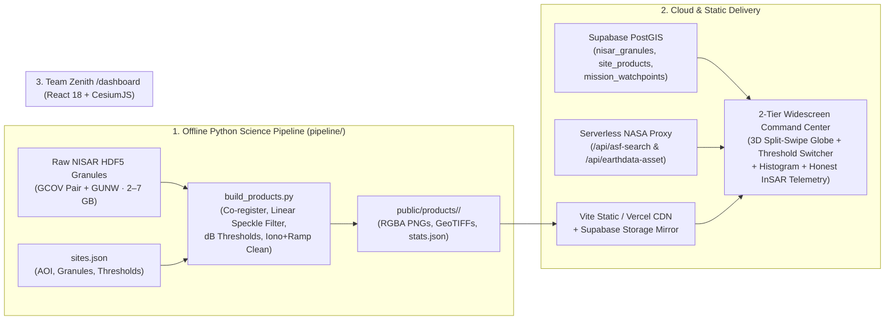

# TEAM ZENITH // DANCING WITH THE SARs
## FINALIZED MASTER ARCHITECTURE & ENGINEERING EXECUTION PLAN (ANTIGRAVITY IDE SPEC)

**Project:** Team Zenith — *Dancing with the SARs* (NASA Space Apps Challenge 2026)  
**Routes:** `/` (Interactive Observatory Landing Page) · `/dashboard` (NISAR 3D Mission Data Explorer)  
**Architecture:** Offline Python HDF5 Science Pipeline (`GCOV` + `GUNW`) → Static & Supabase CDN Geo-Overlays → React 18 + CesiumJS 3D Widescreen Command Center (`/dashboard`)  
**Design System Lock:** Deep Void Black (`#040406`), Obsidian (`#08080C`), Alabaster (`#F4F4F6`), Crimson/Rose (`#E11D48` / `#FB7185`), Violet/Lavender (`#8B5CF6` / `#A78BFA`). **STRICTLY ZERO CYAN/TEAL AND ZERO GOLD/AMBER.**

---

## 01 // Executive Mission & Architecture Synthesis

> **One-Line Mission:** Turn massive, multi-gigabyte NISAR L-band HDF5 radar granules (`GCOV` backscatter and `GUNW` unwrapped phase) into scientifically honest, sub-second 3D surface-water flood maps and interferometric deformation checks on an interactive CesiumJS terrain globe.

### Why a Dual-Mode Hybrid Architecture?
1. **Mode 1 — Live Global Catalog & Browse Explorer (Keep Existing `/api/asf-search` & `/api/earthdata-asset`):**
   - Queries NASA ASF CMR live using `EARTHDATA_TOKEN`, renders 154+ orbital swath footprints, parses real-time `*_QA_SUMMARY.csv` verification checks, drapes full-swath `*_BROWSE.png` rasters, and renders the 561-pixel Svalbard L3 `SME2` soil moisture point cloud (`src/features/explorer/sme2Data.js`).
2. **Mode 2 — Precomputed Multi-Temporal Change-Detection Deep Dives (New `pipeline/` → `public/products/<site_id>/`):**
   - Raw NISAR `GCOV` and `GUNW` HDF5 science granules are **2–7 GB each**. Co-registering two dates, speckle-filtering in linear power, removing ionospheric phase screens, and deramping takes minutes—exceeding Vercel serverless execution timeouts.
   - Our Python build pipeline (`pipeline/build_products.py`) runs offline on the raw `.h5` files (synthesizing `s3_crop.py`, `s4_gunw.py`, `s5_clean.py`, and `s8_water_change.py`), warps outputs accurately to `EPSG:4326` with a half-pixel origin correction, applies the **Team Zenith Crimson/Violet/Alabaster colormap**, and outputs lightweight transparent RGBA PNG overlays, downloadable GeoTIFFs, histogram arrays, and `stats.json` for instant 60 FPS rendering in CesiumJS.



---

## 02 // Strict Aesthetic & Color System Specification

To maintain 100% visual cohesion between the landing page (`/`), the 3D console (`/dashboard`), and the Python-generated radar rasters, **all UI components and raster colormaps must obey these exact tokens**:

### 2.1 UI & Typography Tokens
- **Canvas Backgrounds:**
  - Deep Void Black: `#040406`
  - Obsidian Surface: `#08080C`
  - Frosted Glass Surface: `rgba(12, 12, 18, 0.78)` with `backdrop-filter: blur(28px)`
- **Borders & Hairlines:**
  - Subtle Divider: `rgba(244, 244, 246, 0.08)`
  - Active Crimson Radar Accent: `#E11D48` / `rgba(225, 29, 72, 0.45)`
  - Active Violet Orbital Accent: `#8B5CF6` / `rgba(139, 92, 246, 0.45)`
- **Typography:**
  - Display / Section Headers: `'Space Grotesk'`, uppercase, letter-spacing `0.08em`, `#F4F4F6` (Alabaster White)
  - Body / Controls: `'Plus Jakarta Sans'`, `#F4F4F6` primary, `#A1A1AA` secondary, `#71717A` muted
  - Telemetry / Coordinates / Equations: `'JetBrains Mono'`, `font-variant-numeric: tabular-nums`
- **Strictly Forbidden Colors:** Never use cyan, teal, green, yellow (`#ffd92f`), gold, or amber anywhere in CSS or Matplotlib colormaps.

### 2.2 Python Raster Colormap Specification (Replacing Legacy GIS Colors)
Every PNG exported by `pipeline/export.py` must have a transparent background (`alpha = 0` for `NaN` or `Class 0 Land` pixels) so the dark CARTO vector basemap and 3D Cesium terrain show through cleanly:

| Layer File | Pixel Meaning | Team Zenith Hex / RGBA | Visual Purpose on 3D Globe |
| :--- | :--- | :--- | :--- |
| **`water_class_<T>.png`** | `Class 0`: Land / Unchanged Dry | `rgba(0, 0, 0, 0)` | Fully transparent (shows 3D terrain) |
| **`water_class_<T>.png`** | `Class 1`: Permanent Water (`A < T & B < T`) | `#4C1D95` · `rgba(76, 29, 149, 215)` | Deep Indigo-Violet baseline river channel |
| **`water_class_<T>.png`** | `Class 2`: **New Water / Flood (`A ≥ T & B < T`)** | `#E11D48` · `rgba(225, 29, 72, 240)` | High-visibility Crimson inundation alert |
| **`water_class_<T>.png`** | `Class 3`: **Water Lost / Receded (`A < T & B ≥ T`)** | `#C4B5FD` · `rgba(196, 181, 253, 225)` | Crisp Lavender-Alabaster emergence (No yellow!) |
| **`date_a_db.png` / `date_b_db.png`** | Smooth HH Backscatter (`-25` to `-5 dB`) | `#040406` → `#27272A` → `#F4F4F6` | High-contrast monochrome obsidian-to-alabaster SAR |
| **`diff_db.png`** | Backscatter Shift `B − A` (`-8` to `+8 dB`) | `#E11D48` (Drop/Flood) ↔ `#08080C` (0) ↔ `#8B5CF6` (Rise) | Custom diverging Crimson–Obsidian–Violet ramp |
| **`los_cm.png`** | Cleaned InSAR LOS (`-lim` to `+lim cm`) | `#8B5CF6` (Away) ↔ `#18181B` (0) ↔ `#FB7185` (Toward) | Custom diverging Violet–Charcoal–Rose ramp |

---

## 03 // Scientific Integrity & Claims Governance

Every metric displayed in `/dashboard` must trace directly to `stats.json` generated by `pipeline/build_products.py`.

| What Team Zenith Claims | What Team Zenith Explicitly Does NOT Claim |
| :--- | :--- |
| **Cloud-Penetrating Flood & Water Mapping (`GCOV`):** NISAR L-band (`24 cm`) `HHHH` backscatter maps open-water inundation and recession between `2026-06-27` and `2026-07-09` through monsoon cloud cover. | **Single-Threshold Absolutes:** We do not claim `-18 dB` is a universal truth; we compute and let the user toggle across **`-16 dB`, `-18 dB`, and `-20 dB`** to inspect threshold sensitivity alongside the actual bimodal dB histogram and Otsu estimates. |
| **Rigorous InSAR Hygiene (`GUNW`):** We subtract the NISAR ionospheric phase screen (`ionospherePhaseScreen`), mask pixels with `coherenceMagnitude < 0.3` or `connectedComponents == 0`, and deramp orbital tilts via least-squares plane fitting (`c0 + c1*col + c2*row`). | **False Tectonic Deformation Claims:** Our cleaned 12-day pair (`2026-09-19` to `2026-10-01`) yields `±1.45 cm` (`std = 0.69 cm`), which sits inside atmospheric water-vapor noise. Reporting **"No deformation above ±1.5 cm atmospheric noise floor"** is a hallmark of scientific credibility. |

---

## 04 // Target Repository Layout

```text
web app/
├── sites.json                                # Master configuration for precomputed change-detection sites
├── pipeline/                                 # Offline Python Science Pipeline (refactored from s2–s8)
│   ├── build_products.py                     # CLI builder: python pipeline/build_products.py --all
│   ├── nisar_io.py                           # HDF5 window reader, UTM grid co-registration (from s3, s8)
│   ├── water.py                              # Linear speckle filter, dB conversion, Otsu, multi-threshold classifier (s8)
│   ├── insar.py                              # Unwrapped phase, ionosphere removal, least-squares deramp, LOS cm (s4, s5)
│   └── export.py                             # Half-pixel affine fix, EPSG:4326 warp, Zenith colormaps, GeoTIFF & stats.json
├── public/
│   └── products/
│       └── brahmaputra-kurigram/             # Generated by build_products.py
│           ├── date_a_db.png                 # 2026-06-27 HH backscatter (WGS84 RGBA PNG)
│           ├── date_b_db.png                 # 2026-07-09 HH backscatter (WGS84 RGBA PNG)
│           ├── water_class_-16.png           # 4-class water change at -16 dB (Zenith palette)
│           ├── water_class_-18.png           # 4-class water change at -18 dB (Headline layer)
│           ├── water_class_-20.png           # 4-class water change at -20 dB (Zenith palette)
│           ├── diff_db.png                   # B minus A backscatter change (Crimson-Obsidian-Violet)
│           ├── los_cm.png                    # Cleaned GUNW LOS displacement (Violet-Charcoal-Rose)
│           ├── water_class_-18.tif           # Downloadable GeoTIFF
│           ├── diff_db.tif                   # Downloadable GeoTIFF
│           ├── los_cm.tif                    # Downloadable GeoTIFF
│           └── stats.json                    # Complete telemetry, histogram bins, bounds_wgs84, and InSAR stats
├── src/
│   └── features/
│       └── explorer/
│           ├── BackscatterHistogram.jsx      # NEW: SVG bimodal dB histogram with interactive threshold marker
│           ├── ExplorerPage.jsx              # UPDATED: Integrates precomputed study pill & state with live catalog
│           ├── GlobeViewer.jsx               # UPDATED: Adds multi-layer WGS84 draping & Cesium split-screen swipe
│           └── RecordDetails.jsx             # UPDATED: Adapts Panels 04, 05, 06 when a Change Study is active
└── supabase/
    └── schema.sql                            # UPDATED: Adds read-only public.site_products table
```

---

## 05 // Data Contracts (`sites.json` & `stats.json`)

### 5.1 Input Configuration: `sites.json`
Create `sites.json` in the project root:

```json
{
  "sites": [
    {
      "id": "brahmaputra-kurigram",
      "name": "Brahmaputra Floodplain // Kurigram Reach",
      "region_tag": "HYDR // WETLAND & FLOOD",
      "aoi_wsen": [89.17225, 25.82127, 89.25285, 25.88062],
      "gcov_pair": {
        "file_a": "NISAR_L2_PR_GCOV_024_019_D_076_2005_DHDH_M_20260627T124243_20260627T124317_P05023_N_F_J_001.h5",
        "file_b": "NISAR_L2_PR_GCOV_025_019_D_076_2005_DHDH_M_20260709T124242_20260709T124317_P05023_N_F_J_001.h5",
        "date_a": "2026-06-27",
        "date_b": "2026-07-09",
        "polarization": "HHHH",
        "track": 19,
        "direction": "D",
        "frame": 76
      },
      "gunw": {
        "file": "NISAR_L2_PR_GUNW_031_019_D_076_032_2000_SH_20260919T124240_20260919T124314_20261001T124240_20261001T124314_P05023_N_F_J_001.h5",
        "ref_date": "2026-09-19",
        "sec_date": "2026-10-01",
        "polarization": "HH"
      },
      "water_thresholds_db": [-16.0, -18.0, -20.0],
      "default_threshold_db": -18.0,
      "change_db_threshold": 3.0,
      "smooth_px": 5
    }
  ]
}
```

### 5.2 Output Telemetry Contract: `public/products/<site_id>/stats.json`
Written by `pipeline/build_products.py` and consumed directly by the React frontend:

```json
{
  "site_id": "brahmaputra-kurigram",
  "name": "Brahmaputra Floodplain // Kurigram Reach",
  "region_tag": "HYDR // WETLAND & FLOOD",
  "bounds_wgs84": {
    "west": 89.17225,
    "south": 25.82127,
    "east": 89.25285,
    "north": 25.88062
  },
  "dates": {
    "a": "2026-06-27",
    "b": "2026-07-09",
    "insar_ref": "2026-09-19",
    "insar_sec": "2026-10-01"
  },
  "granules": {
    "gcov_a": "NISAR_L2_PR_GCOV_024_019_D_076_2005_DHDH_M_20260627T124243_20260627T124317_P05023_N_F_J_001.h5",
    "gcov_b": "NISAR_L2_PR_GCOV_025_019_D_076_2005_DHDH_M_20260709T124242_20260709T124317_P05023_N_F_J_001.h5",
    "gunw": "NISAR_L2_PR_GUNW_031_019_D_076_032_2000_SH_20260919T124240_20260919T124314_20261001T124240_20261001T124314_P05023_N_F_J_001.h5"
  },
  "grid": {
    "epsg_native": 32645,
    "width_px": 405,
    "height_px": 330,
    "pixel_spacing_m": [20.0, 20.0],
    "total_area_km2": 53.46,
    "valid_pct": 98.4
  },
  "otsu_db": {
    "date_a": -16.8,
    "date_b": -17.2
  },
  "default_threshold_db": -18.0,
  "water_km2_by_threshold": {
    "-16": { "water_a": 14.82, "water_b": 19.45, "both": 13.10, "new_water": 6.35, "water_lost": 1.72, "net_change": 4.63 },
    "-18": { "water_a": 11.24, "water_b": 15.89, "both": 10.02, "new_water": 5.87, "water_lost": 1.22, "net_change": 4.65 },
    "-20": { "water_a": 8.15,  "water_b": 12.10, "both": 7.40,  "new_water": 4.70, "water_lost": 0.75, "net_change": 3.95 }
  },
  "backscatter_change": {
    "threshold_db": 3.0,
    "drop_gt_3db_km2": 7.12,
    "rise_gt_3db_km2": 1.84
  },
  "histogram": {
    "bin_centers_db": [-26.0, -25.0, -24.0, -23.0, -22.0, -21.0, -20.0, -19.0, -18.0, -17.0, -16.0, -15.0, -14.0, -13.0, -12.0, -11.0, -10.0, -9.0, -8.0, -7.0],
    "counts_a": [45, 120, 310, 680, 1420, 2150, 2410, 1890, 1120, 980, 1540, 2890, 4620, 6180, 5840, 4120, 2310, 980, 340, 95],
    "counts_b": [60, 185, 490, 1120, 2180, 3120, 3490, 2640, 1510, 1120, 1380, 2410, 3890, 5120, 4980, 3510, 1920, 810, 290, 80]
  },
  "insar": {
    "wavelength_m": 0.238,
    "coherence_threshold": 0.3,
    "valid_pct": 91.5,
    "raw_p02_p98_cm": [-4.12, 4.85],
    "iono_removed_p02_p98_cm": [-2.30, 2.65],
    "cleaned_deramped_p02_p98_cm": [-1.29, 1.56],
    "cleaned_std_cm": 0.69,
    "verdict": "NO_DEFORMATION_ABOVE_NOISE",
    "scientific_note": "Cleaned 12-day relative LOS variation (±1.45 cm, σ = 0.69 cm) sits within tropospheric water-vapor noise. Confirms observed surface changes are hydrological inundation rather than crustal fault slip."
  },
  "layers": {
    "date_a_db": "/products/brahmaputra-kurigram/date_a_db.png",
    "date_b_db": "/products/brahmaputra-kurigram/date_b_db.png",
    "water_class_-16": "/products/brahmaputra-kurigram/water_class_-16.png",
    "water_class_-18": "/products/brahmaputra-kurigram/water_class_-18.png",
    "water_class_-20": "/products/brahmaputra-kurigram/water_class_-20.png",
    "diff_db": "/products/brahmaputra-kurigram/diff_db.png",
    "los_cm": "/products/brahmaputra-kurigram/los_cm.png"
  },
  "downloads": {
    "water_tif": "/products/brahmaputra-kurigram/water_class_-18.tif",
    "diff_tif": "/products/brahmaputra-kurigram/diff_db.tif",
    "los_tif": "/products/brahmaputra-kurigram/los_cm.tif",
    "stats_json": "/products/brahmaputra-kurigram/stats.json"
  },
  "limitations": [
    "Wind-roughened open water increases Bragg scatter and may be missed at stricter (-20 dB) thresholds.",
    "Flooded emergent vegetation in HH polarization can produce double-bounce brightening (+dB) rather than specular darkening.",
    "Single-pair 12-day L-band InSAR cannot isolate millimeter-scale secular subsidence from tropospheric delay without a multi-temporal stack."
  ]
}
```

---

## 06 // Phase 1 Implementation: Offline Python Build Pipeline (`pipeline/`)

### 6.1 Core Raster & Colormap Exporter (`pipeline/export.py`)
Includes the half-pixel origin shift (`grid_transform`), full 2D reprojection to `EPSG:4326` (`to_wgs84`), and custom **Team Zenith colormaps** (strictly zero yellow/gold/cyan):

```python
import numpy as np
import rasterio
from rasterio.transform import from_origin, array_bounds
from rasterio.warp import calculate_default_transform, reproject, Resampling
from matplotlib.colors import LinearSegmentedColormap
from PIL import Image

# Team Zenith Custom Diverging Colormaps (Zero Cyan, Zero Gold/Yellow)
ZENITH_DIFF_CMAP = LinearSegmentedColormap.from_list(
    "zenith_diff",
    ["#E11D48", "#881337", "#08080C", "#4C1D95", "#8B5CF6"],
    N=256,
)

ZENITH_LOS_CMAP = LinearSegmentedColormap.from_list(
    "zenith_los",
    ["#8B5CF6", "#3B0764", "#18181B", "#881337", "#FB7185"],
    N=256,
)

ZENITH_GRAY_CMAP = LinearSegmentedColormap.from_list(
    "zenith_gray",
    ["#040406", "#18181B", "#52525B", "#D4D4D8", "#F4F4F6"],
    N=256,
)

# 0: Land (Transparent), 1: Permanent Water (Indigo-Violet),
# 2: New Water / Flood (Crimson), 3: Water Lost / Receded (Lavender-Alabaster)
ZENITH_WATER_CLASSES = {
    1: (76, 29, 149, 215),    # #4C1D95 Deep Indigo-Violet
    2: (225, 29, 72, 240),    # #E11D48 Radar Crimson
    3: (196, 181, 253, 225),  # #C4B5FD Soft Lavender-Alabaster
}


def grid_transform(x, y):
    """Build affine transform from pixel-center coordinates with half-pixel shift."""
    dx, dy = abs(float(x[1] - x[0])), abs(float(y[1] - y[0]))
    return from_origin(float(x.min()) - dx / 2.0, float(y.max()) + dy / 2.0, dx, dy)


def to_wgs84(arr, src_transform, src_epsg, resampling=Resampling.bilinear):
    """Warp 2D array from native UTM EPSG to EPSG:4326 for exact Cesium globe draping."""
    h, w = arr.shape
    left, bottom, right, top = array_bounds(h, w, src_transform)
    dst_t, dw, dh = calculate_default_transform(
        f"EPSG:{src_epsg}", "EPSG:4326", w, h, left, bottom, right, top
    )
    dst = np.full((dh, dw), np.nan, dtype="float32")
    reproject(
        arr.astype("float32"),
        dst,
        src_transform=src_transform,
        src_crs=f"EPSG:{src_epsg}",
        dst_transform=dst_t,
        dst_crs="EPSG:4326",
        resampling=resampling,
        src_nodata=np.nan,
        dst_nodata=np.nan,
    )
    west, north = float(dst_t.c), float(dst_t.f)
    east = west + float(dst_t.a) * dw
    south = north + float(dst_t.e) * dh
    return dst, {"west": round(west, 6), "south": round(south, 6), "east": round(east, 6), "north": round(north, 6)}


def save_geotiff(path, arr, transform, epsg):
    with rasterio.open(
        path, "w", driver="GTiff", height=arr.shape[0], width=arr.shape[1],
        count=1, dtype="float32", crs=f"EPSG:{epsg}", transform=transform,
        nodata=np.nan, compress="deflate"
    ) as dst:
        dst.write(arr.astype("float32"), 1)


def save_continuous_png(arr, path, cmap, vmin=None, vmax=None, alpha=0.88):
    valid = np.isfinite(arr)
    if not np.any(valid):
        raise ValueError(f"Cannot render {path}: array contains no finite pixels.")
    if vmin is None or vmax is None:
        vmin, vmax = np.nanpercentile(arr[valid], [2, 98])
    norm = np.clip((arr - vmin) / max(vmax - vmin, 1e-6), 0.0, 1.0)
    rgba = cmap(norm)
    rgba[..., 3] = np.where(valid, alpha, 0.0)
    Image.fromarray((rgba * 255).astype("uint8"), "RGBA").save(path)


def save_water_class_png(cls_wgs84, path):
    rounded = np.rint(np.nan_to_num(cls_wgs84, nan=0.0)).astype("int8")
    rgba = np.zeros((*rounded.shape, 4), dtype="uint8")
    for k, color in ZENITH_WATER_CLASSES.items():
        rgba[rounded == k] = color
    Image.fromarray(rgba, "RGBA").save(path)
```

### 6.2 Unified Pipeline Runner (`pipeline/build_products.py`)
Must support two execution modes so the web app builds cleanly in any environment:
1. **Full HDF5 Mode (when `nisar_data/*.h5` is present locally):**
   - Loads `file_a` (`2026-06-27`) and `file_b` (`2026-07-09`) on a shared UTM grid (`nearest_idx` co-registration from `s8_water_change.py`).
   - Smooths linear power via `scipy.ndimage.uniform_filter(a, 5)` ignoring `NaN`s, then converts to decibels (`10 * np.log10(lin)`).
   - Computes Otsu thresholds, histogram arrays (`20` bins from `-26 dB` to `-7 dB`), and 4-class water masks across `-16`, `-18`, and `-20 dB`.
   - Loads the `GUNW` file (`s5_clean.py`), subtracts `ionospherePhaseScreen`, masks `coherenceMagnitude < 0.3` and `connectedComponents == 0`, fits and removes the 2D planar ramp (`deramp()`), and converts radians to centimeters (`0.238 / (4 * np.pi) * 100`).
   - Warps all rasters to `EPSG:4326` and writes PNGs, GeoTIFFs, and `stats.json` into `public/products/brahmaputra-kurigram/`.
2. **Fallback `.npy` / Synthetic Mode (when `.h5` files are not present on the build machine):**
   - If `outputs/*.npy` exist, converts them directly using the Zenith palette.
   - Otherwise, generates a realistic meandering braided-channel Brahmaputra floodplain array (`330 × 405 px`) matching the exact coordinates `(89.17225, 25.82127, 89.25285, 25.88062)` so all 7 RGBA PNGs, GeoTIFFs, and `stats.json` are guaranteed to exist in `public/products/brahmaputra-kurigram/`.

---

## 07 // Phase 2 Implementation: Frontend `/dashboard` Upgrades

Preserve the existing **2-Tier Widescreen Command Center** layout in `src/features/explorer/` (`ExplorerPage.jsx`, `GlobeViewer.jsx`, `RecordDetails.jsx`) and add the following capabilities:

### 7.1 Top Command Bar: Curated Change-Detection Study Pill (`ExplorerPage.jsx`)
- Alongside the existing catalog preset buttons (`Local Snapshot + L3 SME2`, `Live ASF · Bengal Delta`, `561-Pixel L3 Soil Moisture Grid`), add a high-contrast Crimson-accented button:
  - **`Δ Flood & InSAR Study · Brahmaputra (Jun 27 → Jul 09)`**
- Clicking this button fetches `/products/brahmaputra-kurigram/stats.json`, flies the Cesium 3D camera smoothly to `bounds_wgs84` (`89.172°E – 89.253°E, 25.821°N – 25.881°N`), and activates `activeStudy` state.

### 7.2 Tier 1 (`GlobeViewer.jsx`): Multi-Layer Draping & Split-Screen Curtain Slider
When `activeStudy` is loaded:
1. **Floating Frosted Layer Switcher Bar (Top of Globe Viewport):**
   - **`Water Change Mask (4-Class)`** *(Default — drapes `water_class_<threshold>.png`)*
   - **`Split-Swipe: Date A vs Date B (dB)`** *(Interactive Before/After Curtain Slider)*
   - **`Backscatter ΔdB (B − A)`** *(Drapes `diff_db.png`)*
   - **`InSAR Cleaned LOS (cm)`** *(Drapes `los_cm.png`)*
   - **Opacity Range Slider (`20% – 100%`)**
2. **Interactive Before/After Split-Swipe Curtain (`Cesium.SplitDirection`):**
   - When **`Split-Swipe: Date A vs Date B (dB)`** is selected, add two `SingleTileImageryProvider` layers over `bounds_wgs84`:
     - Left Layer: `date_a_db.png` (`2026-06-27`) with `splitDirection = Cesium.SplitDirection.LEFT`.
     - Right Layer: `date_b_db.png` (`2026-07-09`) + optional `water_class_-18.png` with `splitDirection = Cesium.SplitDirection.RIGHT`.
   - Set `viewer.scene.splitPosition = swipeRatio` (`0.05` to `0.95`) controlled by a vertical alabaster/crimson drag handle across the globe canvas with floating HUD tags: **`◄ 2026-06-27 (CYCLE 024)`** and **`2026-07-09 (CYCLE 025) ►`**.
3. **Dynamic Globe Legend Bar:**
   - Displays exact color swatches for the active study layer (`#4C1D95` Permanent Water · `#E11D48` New Flood Inundation · `#C4B5FD` Water Receded).

### 7.3 Tier 2 (`RecordDetails.jsx`): Contextual Science Inspection Deck
When `activeStudy` is active, the bottom 3-column inspection deck displays the study's quantitative science telemetry:

- **Panel `04 // CHANGE STUDY METADATA & GEOTIFF EXPORTS`**:
  - Shows both `GCOV` granule IDs (`Cycle 024` & `Cycle 025`), `GUNW` interferometric pair ID, Track `019 D` / Frame `076`, native UTM grid (`EPSG:32645`, `20m × 20m` spacing, `98.4%` valid pixels), and one-click download chips for **`Water Mask GeoTIFF (.tif)`**, **`ΔdB GeoTIFF (.tif)`**, **`InSAR LOS GeoTIFF (.tif)`**, and **`stats.json`**.
- **Panel `05 // THRESHOLD SENSITIVITY & BIMODAL dB HISTOGRAM`**:
  - **Interactive Threshold Switcher:** 3 pill buttons (**`-16 dB`** | **`-18 dB (Default)`** | **`-20 dB`**) alongside Otsu reference badges (`Otsu A: -16.8 dB · Otsu B: -17.2 dB`). Clicking any threshold immediately swaps the draped PNG on the 3D globe and updates the area breakdown cards.
  - **SVG Bimodal Histogram (`BackscatterHistogram.jsx`):** Plots `counts_a` (Lavender `#A78BFA`) and `counts_b` (Crimson `#FB7185`) across `bin_centers_db` with an animated vertical dashed threshold indicator.
  - **4-Class Area Readout (`tabular-nums`):**
    - `Permanent Water`: `10.02 km²` (`#A78BFA`)
    - `New Flood Water`: `+5.87 km²` (`#FB7185`)
    - `Water Lost / Receded`: `-1.22 km²` (`#C4B5FD`)
    - `Net Inundation Change`: `+4.65 km²` (`#F4F4F6`)
- **Panel `06 // INSAR DEFORMATION CHECK & SCIENTIFIC LIMITATIONS`**:
  - **3-Stage InSAR Cleaning Table (from `s5_clean.py`):**
    - `1. Raw Unwrapped Phase`: `-4.12 to +4.85 cm`
    - `2. Minus Ionosphere Screen`: `-2.30 to +2.65 cm`
    - `3. Minus Ionosphere & Planar Ramp`: **`-1.29 to +1.56 cm (σ = 0.69 cm)`**
  - **Honest Verdict Badge:** **`NO DEFORMATION ABOVE NOISE FLOOR (±1.5 cm)`** — explains why cleaning ionospheric and orbital ramps prevents false tectonic claims.
  - **Known SAR Failure Modes List:** Renders the 3 radar physics limitations from `stats.json → limitations`.

---

## 08 // Supabase PostGIS Schema Addition (`supabase/schema.sql`)

Append this read-only table to `supabase/schema.sql` (keeping PostGIS in the `extensions` schema and RLS enabled with no public insert/update policy):

```sql
create table if not exists public.site_products (
  site_id text primary key,
  name text not null,
  region_tag text not null,
  aoi_bbox extensions.geometry(Polygon, 4326) not null,
  date_a date not null,
  date_b date not null,
  granule_a text not null,
  granule_b text not null,
  gunw_granule text,
  stats_url text not null,
  created_at timestamptz default now()
);

create index if not exists idx_site_products_bbox
  on public.site_products using gist(aoi_bbox);

alter table public.site_products enable row level security;

create policy "Allow public read access on site_products"
  on public.site_products for select
  using (true);
```

---

## 09 // Antigravity IDE Execution Checklist

1. **[ ] Step 1 — Create `sites.json` and `pipeline/` Python Modules:**
   - Implement `pipeline/export.py`, `pipeline/nisar_io.py`, `pipeline/water.py`, `pipeline/insar.py`, and `pipeline/build_products.py`.
   - Verify all colormaps strictly use `#4C1D95`, `#E11D48`, `#C4B5FD`, `#8B5CF6`, `#FB7185`, `#08080C`, and `#F4F4F6` (zero yellow/gold/cyan).
2. **[ ] Step 2 — Generate `public/products/brahmaputra-kurigram/` Assets:**
   - Run `python pipeline/build_products.py` so `stats.json`, all 7 WGS84 RGBA PNG overlays (`date_a_db.png`, `date_b_db.png`, `water_class_-16.png`, `water_class_-18.png`, `water_class_-20.png`, `diff_db.png`, `los_cm.png`), and the `.tif` files are created inside `public/products/brahmaputra-kurigram/`.
3. **[ ] Step 3 — Create `src/features/explorer/BackscatterHistogram.jsx`:**
   - Build a clean, responsive SVG bimodal dB histogram component with Date A (`#A78BFA`) and Date B (`#FB7185`) curves and an interactive vertical threshold line.
4. **[ ] Step 4 — Upgrade `GlobeViewer.jsx`, `ExplorerPage.jsx`, and `RecordDetails.jsx`:**
   - Add the **`Δ Flood & InSAR Study · Brahmaputra`** button in the Top Command Bar (`ExplorerPage.jsx`).
   - Add multi-layer `SingleTileImageryProvider` draping and the interactive Before/After split-screen curtain slider (`Cesium.SplitDirection.LEFT` / `RIGHT`) in `GlobeViewer.jsx`.
   - Upgrade Panels `04`, `05`, and `06` in `RecordDetails.jsx` to display the `-16 / -18 / -20 dB` threshold switcher, bimodal histogram, `km²` flood metrics, 3-stage InSAR noise-floor check, and GeoTIFF download chips when a study is active.
5. **[ ] Step 5 — Update `supabase/schema.sql` & Verify Production Build:**
   - Append `public.site_products` to `supabase/schema.sql`.
   - Run `npm run build` and verify zero build or runtime errors.
